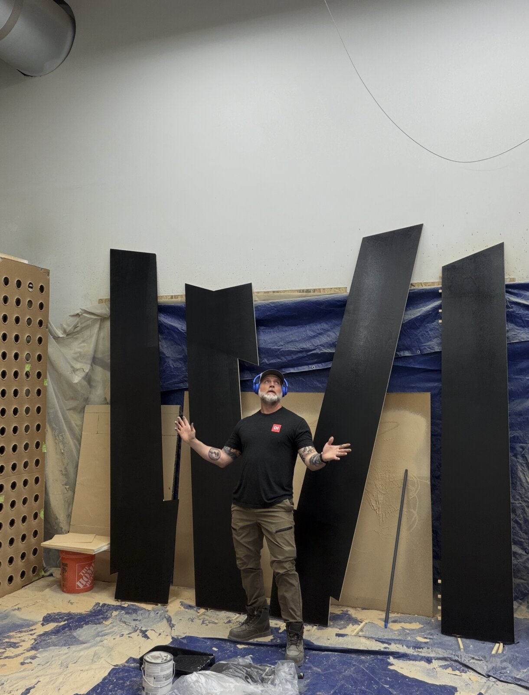
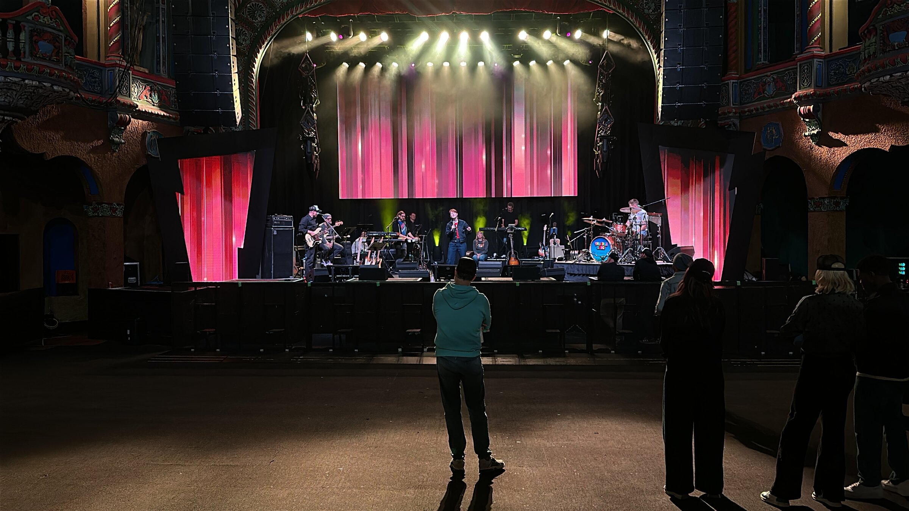
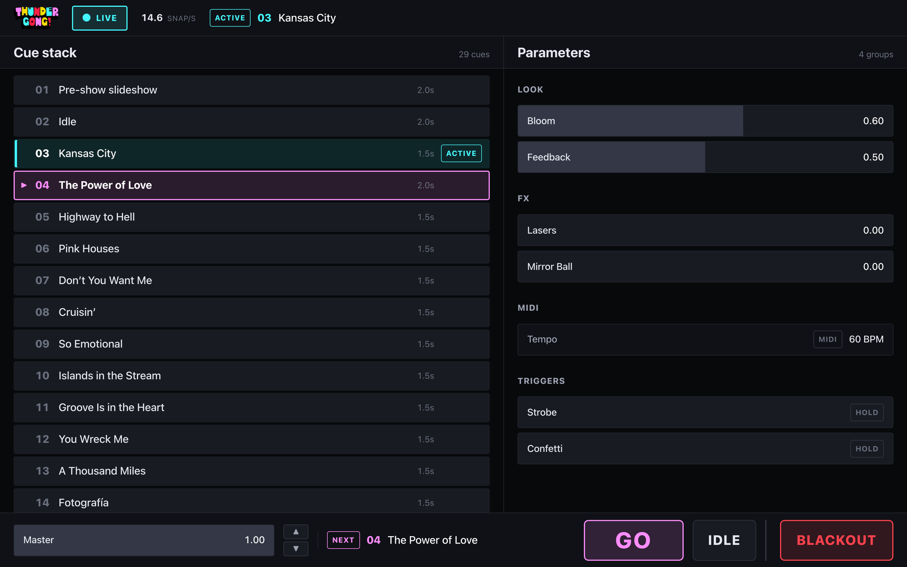
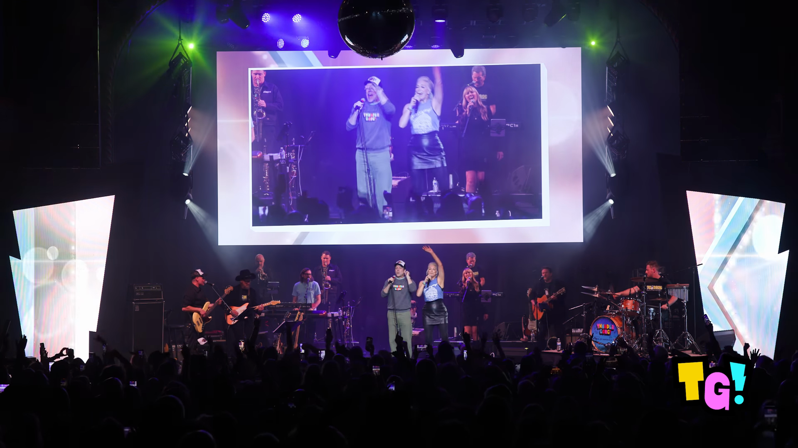
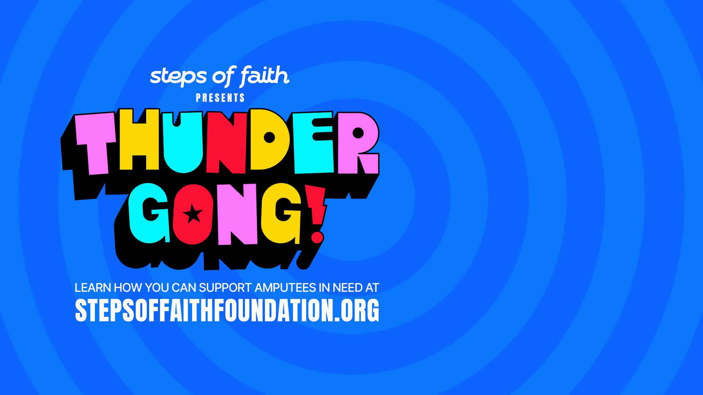

This year was the 10th anniversary of [THUNDERGONG!](https://thundergong.org), the benefit concert for the [Steps of Faith Foundation](https://www.stepsoffaithfoundation.org/) hosted by Jason Sudeikis. It's also the fifth year that a few of us from [Dimensional Innovations](https://dimin.com) have volunteered to make the visuals for it. So, no pressure.

Except we got a late start. We really started building the show with about ten days to go, and I was nervous. 27 songs, each needing its own look, a stage full of LED walls, and a week and a half to do it. I honestly wasn't sure we'd make anything good.

We ended up making what I think is the best show we've ever done. Here's Jason opening the night with "Kansas City" by The New Basement Tapes:

<div class="video-embed"><iframe src="https://www.youtube.com/embed/z3xv17fS-yg" title="Jason Sudeikis performs Kansas City at THUNDERGONG! 2026" loading="lazy" allow="accelerometer; autoplay; clipboard-write; encrypted-media; gyroscope; picture-in-picture; web-share" allowfullscreen></iframe></div>

That didn't happen by just working harder for ten days. It happened because we found a few new ways of working that let three people do the job of a much bigger team. This post is about those: a control surface built as a website, a Remotion pipeline that let two non-coders make broadcast-ready motion graphics in parallel, a design system written for AI agents to read, and a kit of TouchDesigner effects I'm now open-sourcing.

<video class="video-loop" src="/images/blog/thundergong-2026/loops/G01_open_logo_to_imag.mp4" autoplay muted loop playsinline preload="metadata"></video>

## The stage

The LED walls were the same as in past years: a center wall plus a wall at stage left and stage right. In TouchDesigner that's one 6720×2048 canvas.

What was new this year came from Chris Bohatyritz, a fabricator at DI. He built logo-shaped forms that wrap around the left and right walls, so the side walls echo the angled strokes of this year's THUNDERGONG! mark. It's a small thing that makes the whole stage look like it belongs to the brand rather than a rental.



_Chris and the forms in the shop, before they went to the Uptown._



_Rehearsal at the Uptown. You can see how the forms turn the rectangular side walls into part of the logo._

## Two clocks

To be fair about the "ten days": the project had two clocks.

The control system doesn't need to know anything about the show. Cue plumbing, a websocket protocol and a control UI can all be built before anyone knows a single song, so I did that work back in August. The creative work had to wait for the setlist. Once we had it, the Remotion project went in on November 5, the first effect block on November 8, and we played the show on November 14. Most of the project repo's 165 commits fall in that last stretch.

That split turned out to be the first good decision. When the setlist arrived, the plumbing was already boring, and boring is exactly what you want from plumbing.

## The control surface is a website

In past years, I built all of the show's control UI inside TouchDesigner. It worked, but TD's UI tools are limiting and hard to maintain. Every layout change is a network change, and the result never feels as solid as a plain web page.

The thing is, I'm just faster at building UIs with web tech, and so are coding agents. So this year the control surface is a React app built with Vite into a static site, and **TouchDesigner serves it**. A Web Server DAT handles HTTP for the built files and a WebSocket on the same port, so there's one component, one port and no CORS to worry about.

```
  React UI (browser)               MIDI controller (nanoKEY)
         │                                  │
    intents (JSON)                     MIDI In CHOP
         │                                  │
    Web Server DAT ──► dispatch ──► control_target (Table DAT)
         ▲                                  │
         └──── full state snapshot ─────────┤
               every tick (~15 Hz)          ├──► Lag CHOP ──► render
                                            └──► snapshot broadcaster
```

A few design decisions did most of the work:

- **TouchDesigner is authoritative.** The browser only sends intents ("set this to 0.42", "go to cue `verse_2`") and never sends state. TD applies the change and broadcasts the full resulting state back. It's the authoritative-server model from game networking, and it means a browser refresh mid-show is a five-second annoyance, not the end of the set. Reconnect, get a snapshot, and you're correct again.
- **Full snapshots, never deltas.** About 30 controls serialize to well under a kilobyte. Sending everything every tick removes a whole class of "the UI missed an update and is now slightly wrong" bugs. It also means the broadcast deliberately has no "only send when something changed" check, so the state stream doubles as a heartbeat. If the browser stops hearing from TD, TD is in trouble, and the UI says so.
- **Clicking never changes the stage.** Clicking a cue only _arms_ it. GO fires it, and blackout has its own dedicated button that fires immediately. That's the standard lighting-console model, and it means no stray click anywhere in the cue list can change what the audience sees.
- **One cue file shared by both sides.** The UI imports `cues.json` and TD reads the same file. When the browser connects, TD sends the cue IDs it has loaded, and the UI shows a red banner if they don't match. That catches the case where someone is running stale code and would otherwise silently fire the wrong cue.



_The control surface. Cyan marks the cue that's live on the walls, pink marks the one armed to fire next, and GO and BLACKOUT never scroll out of reach. The brand colors only ever signal state, because big saturated fills are rough on the eyes in a dark venue._

One benefit I didn't plan for: because it's just a web page, I could drive the walls from anywhere on the same Wi-Fi network. I could walk out into the house during rehearsal, pull up the surface on a laptop and see the change on the wall from where the audience would be sitting. Doing that with a UI built inside TouchDesigner would have meant a remote desktop session and a lot of squinting.

During the show I split the controls by job. I changed modes in the web UI. The nanoKEY Studio, wired straight into TouchDesigner with no browser in the way, handled anything that had to land on a beat: effect hits, plus the slides and videos that had to play at exact show moments. A browser is great for choosing what happens next. It's the wrong place for something that has to hit on the downbeat.

## 27 songs, three people: Remotion

Every song needed its own background, and we had 27 of them. Randall Statler (Executive Creative Director at DI) and Brandon Wood (DI's VP of Engineering and Innovation) were making looks with me. Neither of them is a coder by background.

The tool that made it work is [Remotion](https://www.remotion.dev/), which renders video from React code. I set up a project where every **look** is a pure function: given a set of parameters, the current beat position and the canvas size, draw one frame. No `Math.random()`, no wall clock, no state carried between frames. Because of that, the last frame of a loop matches the first by construction, so every render is a seamless loop locked to the song's tempo. The renders are 6720×2048 at 60 fps, encoded to HEVC.

Here's the part that made the parallel work possible: `npm run package` zips up a self-contained copy of the project, with the brand art, fonts, the Claude Code skills and an onboarding guide, for someone who doesn't have repo access. Randall and Brandon unzipped it, ran one setup command, and used Claude Code to compose presets and invent new looks on their own Macs. They previewed everything in Remotion Studio and rendered the finals themselves. When they had something, `npm run handoff` zipped up just their presets, looks and setlist changes. I unzipped it over the repo, reviewed the `git diff`, ran the tests and published to TouchDesigner.

By show day we had more than 50 looks and over 90 presets: Ring Tunnels, Disco Floors, a Super 8-style photo grid for the Kansas City opener, an 80s weather channel, a wall of incandescent marquee bulbs and much more. Here's a reel with a bunch of them:

<div class="video-embed"><iframe src="https://www.youtube.com/embed/IrAUWwO3xQQ" title="THUNDERGONG! 2026 LED wall looks showreel" loading="lazy" allow="accelerometer; autoplay; clipboard-write; encrypted-media; gyroscope; picture-in-picture; web-share" allowfullscreen></iframe></div>

<video class="video-loop" src="/images/blog/thundergong-2026/loops/G04_bw_montage.mp4" autoplay muted loop playsinline preload="metadata"></video>

_The Kansas City opener's photo grid, built from band photos, rehearsal footage and Kansas City landmarks._

<video class="video-loop" src="/images/blog/thundergong-2026/loops/G05_uptown_to_color_grid.mp4" autoplay muted loop playsinline preload="metadata"></video>

What surprised me most was how polished it all looked. It took some work to dial each look in until it was as good as it could be, but generating motion graphics this way is a really fun and fast way to try ideas.

## A design system written for agents

Fast doesn't help if every look comes back slightly off-brand. With three people and their agents all generating work, it easily could have.

So before any looks existed, I worked with Claude to turn this year's brand guide PDF into a design system packaged as a Claude Code skill. It has the color tokens, approved color pairings and palettes, type rules, the logo and monogram, the exclamation-point mark, the burst patterns, illustrations, and guidance on how each should and shouldn't be used. It's the same idea as a human-readable brand book, structured so an agent can actually follow it.

Then I wired it into Remotion. A `sync-brand` step runs before every render and generates the project's brand module from the design system. The looks skill has a hard rule: colors, palettes, pairings and headlines come from `src/brand/rules.ts`, never a hand-typed hex. Whoever was driving and whatever they asked for, every look drew from the same pool of brand assets and color values.

I knew this setup was going to work when, about an hour into using it, we already had a handful of assets we loved. That was the moment my how-the-heck-are-we-going-to-do-this nerves started to settle.

## Islands in the Stream

Speaking of loving it. Jason and surprise guest Hannah Waddingham did "Islands in the Stream," with an 80s TV studio look on the walls that projects Dolly Parton footage onto the side fields:

<div class="video-embed"><iframe src="https://www.youtube.com/embed/s04YNAQ-0io" title="Jason Sudeikis and Hannah Waddingham perform Islands in the Stream at THUNDERGONG! 2026" loading="lazy" allow="accelerometer; autoplay; clipboard-write; encrypted-media; gyroscope; picture-in-picture; web-share" allowfullscreen></iframe></div>

The [Instagram reel of that performance](https://www.instagram.com/reel/DfyBCM5R50E/) is closing in on **27 million views**. That's a lot of people looking at our LED walls.



## The Will Tracker

The best demonstration of how fast this setup could move had nothing to do with the setlist.

On the Friday before the show there was a national FAA grounding of all flights, and it wrecked Will Forte's travel plans. For most of show day, it looked like he wouldn't reach the venue until around 9 p.m. So we quickly made the **Will Tracker**: an air traffic control radar spread across all three walls. The center wall is the radar scope, with range rings around the venue, a phosphor sweep and planes in holding patterns. The tracked target is Will's head, complete with a data block. A bay of flight strips fills the left wall, and the right wall shows his track readout. The scope zooms in stages from the wide view down to the KC metro and then downtown, so we could run it as a recurring bit through the night and update the audience on his progress.

<div class="video-embed"><iframe src="https://www.youtube.com/embed/LdTgf12LsCo" title="The Will Tracker: an air traffic control radar tracking Will Forte's flight to THUNDERGONG! 2026" loading="lazy" allow="accelerometer; autoplay; clipboard-write; encrypted-media; gyroscope; picture-in-picture; web-share" allowfullscreen></iframe></div>

Luckily, Will made it before showtime and killed it, nailing his performances without a single rehearsal. The Will Tracker never aired. But going from "Will might be late" to a finished, on-brand, three-wall bit in an afternoon is exactly what this workflow was for.

## Effects you can play: td-fxblox

The background loops set the mood for each song. To make the walls feel _live_, I wanted effects I could play on the nanoKEY like an instrument, hitting a pad to slam a burst across the wall right on the snare. In TouchDesigner, I tend to reinvent the same wheels on every project. This time I wanted a kit I could pull off the shelf and mix and match.

So I wrote a Claude Code skill specifically for building composable TouchDesigner effect blocks. Every block follows the same contract:

- **One video TOP in, one out.** Drop it in front of a scene's output.
- **Exact passthrough when idle.** When nothing is triggered, the output is the input, so a forgotten block can't spoil a look.
- **A float `Trigger`, where the value is velocity.** 0 is off, above 0 is on, and how hard you hit the pad shapes the effect. **Hit** blocks fire an envelope on the rising edge, **Hold** blocks sustain while the pad is down, and **Tail** blocks ring out after release.
- **Brand art embedded in the block**, so nothing loads from disk at show time.

The skill is opinionated about how Claude works, too. Claude couldn't connect to TouchDesigner in this project, so every block is generated as a Python build script and run against a stub of TD's API in `pytest` before I ever open it. The stub raises an error on any operator parameter name that isn't in a list verified against Derivative's docs, which puts a stop to the most common way agents break TouchDesigner code: making up plausible parameter names. Then I build the block in TD, test it, tune the values by feel and hand the numbers back so they become the defaults.

With the contract and that context in place, most of the effects worked on the first try. We ended up with 32 blocks, including Shockwave, Sunburst, Strobe, Stutter, Kaleido Burst, Bulb Grid and a very on-brand Thunderclap.

I liked this kit so much that I'm spinning it out into an open-source project: **[td-fxblox](https://github.com/riebschlager/td-fxblox)**. It starts with the 32 effects from this show. Paste one line into the Textport and it builds whichever blocks you name and exports them as `.tox` files.

Map MIDI, OSC or anything else to `Trigger` and play. It's early, and the first prebuilt pack is still going through live checks, but I'd love for other TouchDesigner folks to use it, break it and add their own blocks.

## Ten days, ten years

Looking back, what changed this year wasn't how hard we worked. It was how we worked. In past years, an idea had to get in line behind whoever could build it. This year the tools closed that gap. Someone could describe a look in the afternoon and watch it loop on the wall that night. Teammates who don't write code were making finished motion graphics on their own machines. And a last-minute crisis turned into a new bit for the show instead of a scramble. Ten days used to feel like barely enough time to finish. This year it was enough time to experiment, throw things away, try again, and still end up with the best show we've made.

<video class="video-loop" src="/images/blog/thundergong-2026/loops/G10_crowd_cheer.mp4" autoplay muted loop playsinline preload="metadata"></video>

I'm so grateful to keep making this show with friends, and to Randall, Brandon and Chris for jumping into new ways of working with ten days on the clock. Most of all, I'm grateful it's all for such a great cause. Over ten years, THUNDERGONG! has helped provide prosthetics for thousands of people who couldn't otherwise afford them.



If you'd like to help, head over to the [Steps of Faith Foundation](https://www.stepsoffaithfoundation.org/).
